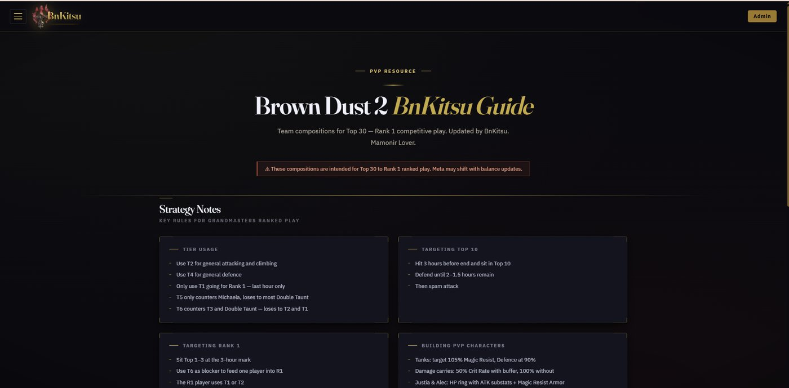

## Overview

A full-stack companion website for the mobile game Brown Dust 2, used by players in the community Discord I help moderate. It gives players a character catalog, tier lists, team compositions with board positioning, an up-to-date coupon code list, and a hidden puzzle hunt that unlocks extra content as visitors explore the site.

The whole site runs serverless on Cloudflare Workers with no frontend framework. Pages are rendered on the server from plain JavaScript modules, and all content lives in a Cloudflare D1 (SQLite) database that I manage through an admin panel I built.

## My Contributions

Solo project, from design through deployment and ongoing maintenance:
- Built the Worker that routes requests and renders every page, with separate modules for pages, API endpoints, layout, and shared libraries.
- Designed the D1 database schema and versioned it with SQL migrations.
- Built an admin CMS for managing characters, costumes, skills, team compositions, tier placements, coupon codes, and images without touching code.
- Implemented admin authentication with HMAC-signed session cookies, a signing key generated and stored server-side, and constant-time signature checks.
- Designed the hidden puzzle hunt, including configurable unlock conditions that are managed from the admin panel.

## What I Learned

- Building and deploying a serverless app end to end on Cloudflare Workers and D1.
- Designing a relational schema and evolving it safely with migrations on a live site.
- Session-based authentication and the details that make it secure.
- Running a real product for real users: taking feedback from the community and shipping fixes.

## Technologies Used

Cloudflare Workers, Cloudflare D1 (SQLite), JavaScript, HTML, CSS, Wrangler

## Links

- [Live Site](https://browndust2-bnkitsu.com)

## Screenshots

*Home page with the PvP guide and strategy notes*
